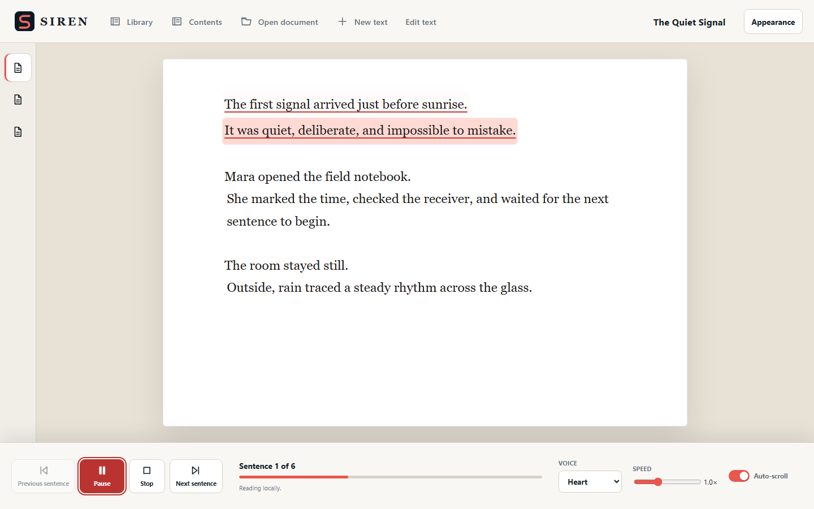
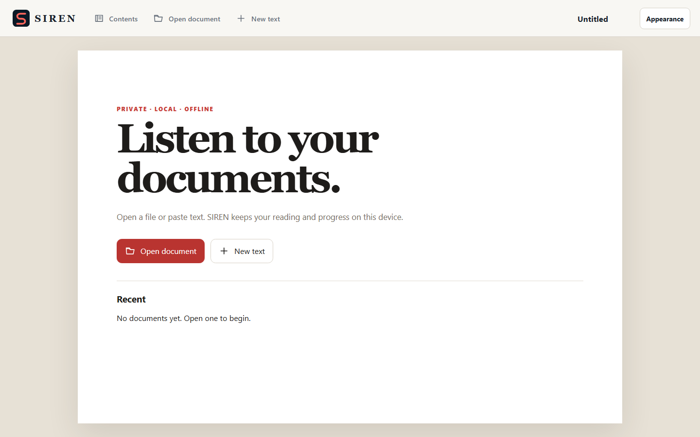
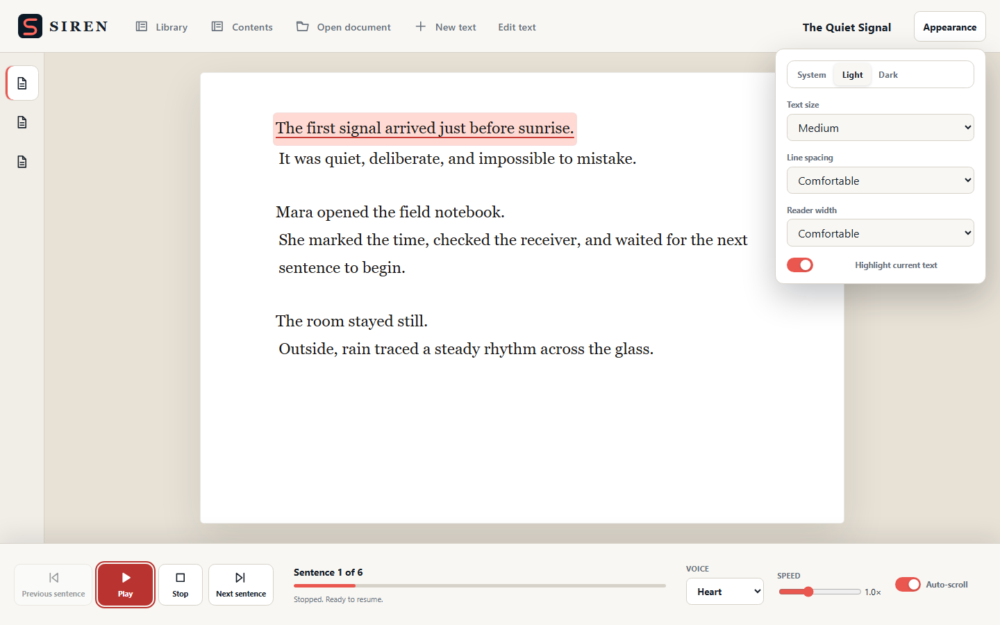
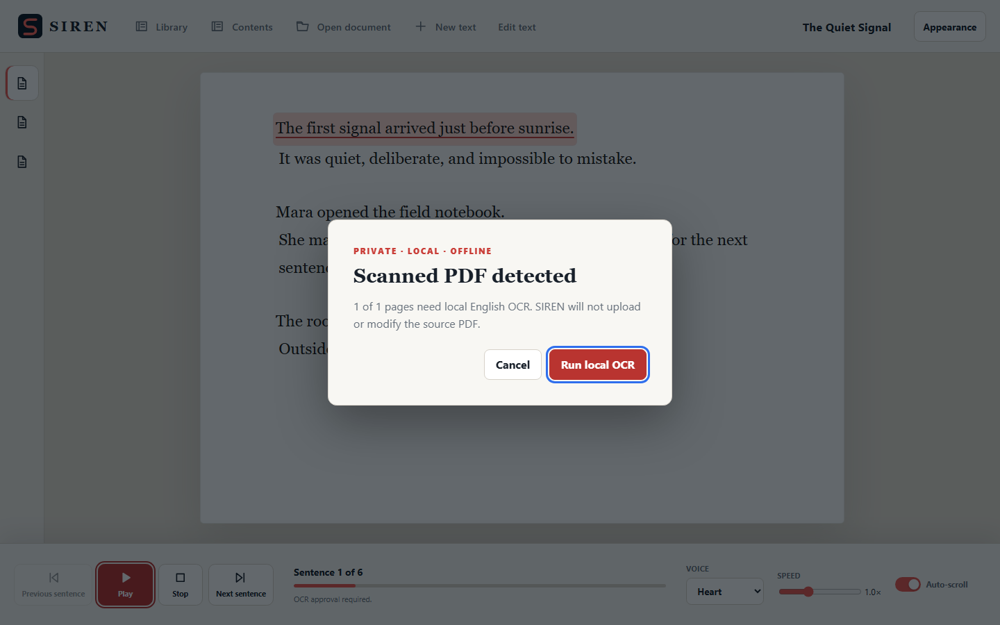

# SIREN

A local read-aloud app for Windows. Open a document, press Play, and it reads
to you with an on-device voice.

I built SIREN for the times I would rather listen to a document than stare at
another page. Everything runs on the machine: the voice is the Kokoro 82M
model, scanned PDFs are recognized locally, and there is no account, cloud TTS
or OCR service involved. It is built with Tauri 2, React, TypeScript and Rust.



The screenshots in this README use a short fictional passage, not a real document.

| Library                                                  | Appearance                                                     | Local OCR prompt for a scanned PDF                             |
| -------------------------------------------------------- | -------------------------------------------------------------- | -------------------------------------------------------------- |
|  |  |  |

## Current status

- **Released:** 1.2.0 (the `v1.2.0` tag), which added local OCR for scanned and mixed PDFs. Screenshots are the release's own committed captures.
- **Platform:** Windows only. Installers are built locally with `npm run tauri build`; release artifacts are not committed.
- **Not included:** DOCX, EPUB, handwriting recognition, voice cloning, cloud sync and audio export.
- **License:** the source is publicly viewable, but I haven't granted an open-source license, so all rights are reserved for now. Third-party components keep their own licenses and are listed in `THIRD_PARTY_NOTICES.md`: the Kokoro 82M model and voices are Apache-2.0, as are Tesseract and the `tessdata_fast` English data.
- **Model files are not in this repo.** The voice model, voices, PDFium and Tesseract are excluded from Git (see below), so a fresh clone builds and tests but won't speak until you drop the model files in `models/`.

## Features

- Buffered local speech with bounded lookahead and near-instant chunk transitions.
- Separate Library and focused Reader surfaces with a Continue action.
- Sentence-oriented Play, Pause/Resume, Stop, Previous, and Next controls.
- Current-sentence highlighting, click-to-read navigation, and auto-scroll that
  yields to manual reading with a Return to current action.
- Persisted text size, line spacing, reader width, highlighting, and theme controls.
- Four bundled Kokoro voices: Bella, Heart, Adam, and Emma.
- Reading speed from 0.5× to 2.0×.
- Dark, Light, and System themes.
- Local settings, recent readings, document text, and sentence position resume.
- On-demand local OCR for text-poor PDF pages, with progress and cancellation.
- Keyboard controls outside text fields: Space to play/pause, Escape to stop,
  Left/Right to navigate, Ctrl+O to open a document, and Ctrl+, for Appearance.

## Supported documents

- `.txt`: Unicode plain text.
- `.md`: headings, links, emphasis, lists, and common inline syntax are reduced
  to readable text.
- `.pdf`: text, scanned, and mixed PDFs up to 50 MB and 500 pages. Existing text
  layers are preserved; OCR is offered only for text-poor pages.

OCR uses bundled English `tessdata_fast` and does not modify the source PDF.
DOCX, EPUB, handwriting recognition, voice cloning, cloud sync, and audio export
are outside 1.2.

## Development

Requirements are Node.js/npm, Rust/Cargo, the Windows MSVC build tools, and the
normal Tauri 2 Windows prerequisites.

```powershell
npm.cmd ci
npm.cmd run check
cargo fmt --manifest-path src-tauri\Cargo.toml -- --check
cargo test --locked --manifest-path src-tauri\Cargo.toml
cargo clippy --locked --manifest-path src-tauri\Cargo.toml --all-targets -- -D warnings
```

Run the desktop app with `npm.cmd run tauri dev`. Run the complete Forge-derived
gate with `powershell -ExecutionPolicy Bypass -File scripts\validate.ps1`.

## Local Kokoro assets

Model files are intentionally excluded from Git. For development, place these
official `onnx-community/Kokoro-82M-v1.0-ONNX` files at:

- `models/model_quantized.onnx`
- `models/voices/af_bella.bin`
- `models/voices/af_heart.bin`
- `models/voices/am_adam.bin`
- `models/voices/bf_emma.bin`

`SIREN_MODEL_DIR` may override that directory for development. Production
installers bundle the model and voices as Tauri resources, so users do not
manually provision assets.

## Local OCR assets

OCR runtime files are excluded from Git. Release builds stage the pinned PDFium
and Tesseract files under `ocr/`; exact versions, sources, licenses, and SHA-256
values are recorded in `THIRD_PARTY_NOTICES.md` and
`docs/OCR_RUNTIME_SHA256.txt`. `SIREN_OCR_DIR` may override the directory in
development. Production resolves only bundled resources.

## Packaging

```powershell
npm.cmd run tauri build
```

The Windows NSIS installer is written under
`src-tauri\target\release\bundle\nsis`. Model and OCR runtimes add roughly
270 MB before installer compression. Release artifacts are build output and are
not committed.

## Persistence and privacy

SIREN stores settings and up to eight recent reading bodies in the app webview's
versioned local storage. Keeping the normalized text locally lets a reading
resume even if its source file is later moved. OCR results are cached by PDF
content hash plus OCR-engine identity, so reopening the same file does not repeat
work. Appearance cleanup removes cached document text but not user source files.
The storage ceiling is the webview's local quota; SQLite remains the upgrade path
if book-scale libraries exceed it. Documents, OCR results, and synthesized audio
are not sent to a remote service.

## Known limitations

- First speech after launch can take several seconds on CPU while its first
  paragraph-sized chunk is synthesized.
- Adjacent sentences may share one audio chunk. Navigation and resume remain
  sentence-indexed; highlighting covers the active chunk because Kokoro does not
  provide sentence timestamps.
- PDF extraction and OCR follow page order; complex multi-column layouts may be
  read in an imperfect order. OCR currently uses the bundled English model.
- Cancellation stops before the next OCR page; an in-flight page may finish
  locally before temporary files are removed.
- Pause resumes the current audio sample; Stop preserves the sentence position.
- Sentence segmentation uses the native `Intl.Segmenter` plus common English
  abbreviation handling rather than a heavyweight NLP runtime.

See `docs/ARCHITECTURE.md`, `THIRD_PARTY_NOTICES.md`, and `STATUS.md` for design,
licensing, and verified build status.
